# homebrew-urna

homebrew tap for [urna](https://github.com/hoffresearch/urna).

```sh
brew install hoffresearch/urna/urna
urna doctor
```



the formula in `Formula/` is generated by cargo-dist on every tagged release of `hoffresearch/urna`; do not edit it by hand. the formula installs the binary only: run the one-liner from the urna readme (or copy `python/forge/` into `${XDG_DATA_HOME:-~/.local/share}/urna/forge/`) to lay down the offline embedder payload that `urna doctor` checks.
